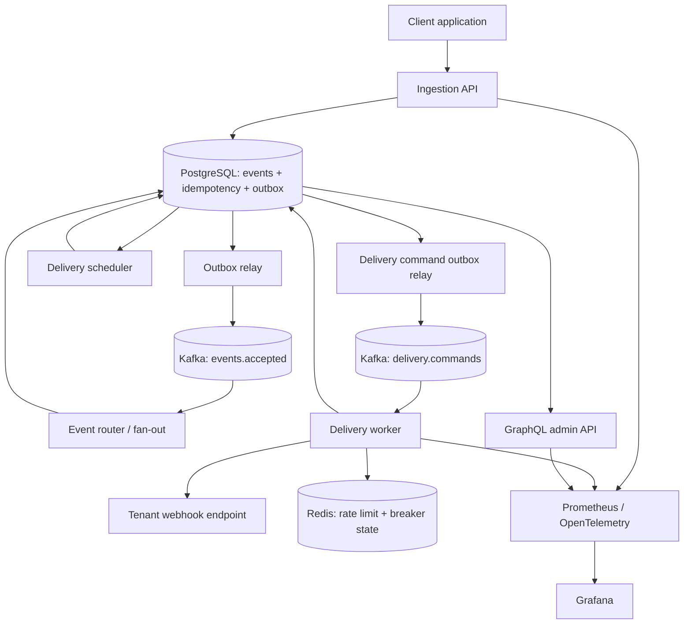
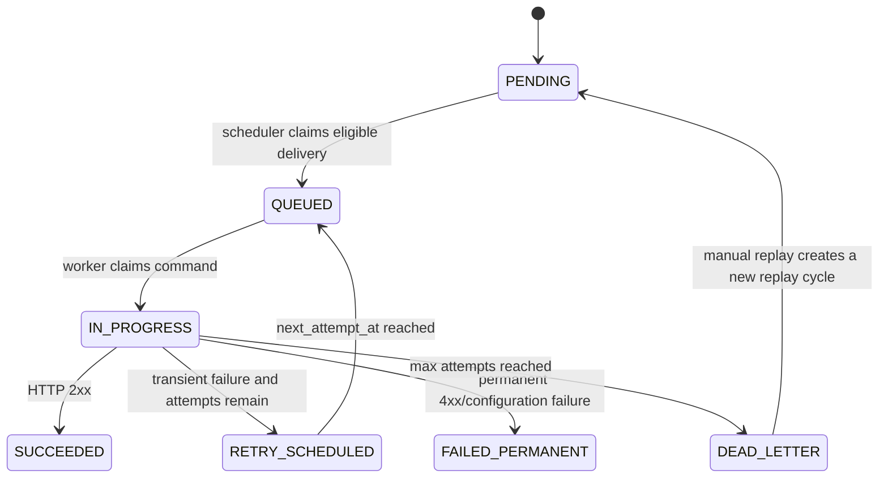

# HookRelay — Final Project Specification & Execution Plan

**Status:** Approved baseline — Package A  
**Project type:** Backend / Distributed Systems / Reliability Engineering portfolio project  
**Document version:** 1.0  
**Date:** 22 October 2026  
**Working name:** HookRelay

> Dokumen ini menjadi sumber kebenaran utama untuk scope, requirement, arsitektur, acceptance criteria, implementasi, dan Definition of Done (DoD). Perubahan desain yang berdampak pada reliability, security, atau kontrak API harus dicatat sebagai Architecture Decision Record (ADR).

---

## 1. Executive Summary

HookRelay adalah platform backend multi-tenant yang menerima event dari aplikasi klien, menyimpannya secara durable, lalu meneruskannya ke endpoint webhook milik tenant. Platform menyediakan idempotency, HMAC signature, retry dengan exponential backoff dan jitter, dead-letter queue (DLQ), circuit breaker, rate limiting, riwayat delivery, API administrasi GraphQL, dan observability.

Contoh use case: sistem e-commerce mengirim event `payment.succeeded`. Jika endpoint penerima sedang down, HookRelay menyimpan event, melakukan retry sesuai kebijakan, dan menampilkan hasil akhirnya. Klien tidak perlu membangun mekanisme retry dan monitoring yang sama di setiap aplikasi.

### 1.1 Tujuan utama

1. Membuktikan event yang memperoleh respons HTTP `202 Accepted` telah tersimpan secara durable di PostgreSQL bersama record outbox.
2. Mengirim event secara asynchronous melalui Kafka dan mengelola status masing-masing delivery.
3. Mencegah pembuatan event ganda akibat request masuk berulang menggunakan `Idempotency-Key`.
4. Menandatangani request webhook dengan HMAC-SHA256 agar penerima dapat memverifikasi keaslian pesan.
5. Memulihkan pengiriman yang gagal melalui retry terjadwal, DLQ, dan manual replay.
6. Membatasi dampak kegagalan endpoint, termasuk timeout, circuit breaker, bulkhead, dan isolasi pekerjaan.
7. Menunjukkan bukti engineering melalui automated tests, failure-injection tests, load tests, metrik, diagram, ADR, dan dokumentasi berbahasa Inggris.

### 1.2 Prinsip yang tidak boleh dilanggar

- **PostgreSQL adalah sumber kebenaran untuk state bisnis.** Kafka adalah transport dan buffer pekerjaan, bukan satu-satunya tempat status delivery tersimpan.
- **`202 Accepted` baru diberikan setelah transaksi database berhasil commit.** Transaksi mencakup event, idempotency record, dan outbox record.
- **Jangan mengklaim exactly-once delivery end-to-end.** Semantik platform adalah at-least-once. Penerima perlu melakukan deduplikasi menggunakan event ID.
- **Jangan memakai `Thread.sleep()` untuk menunggu retry.** Retry harus dijadwalkan secara durable, bukan menahan thread atau consumer Kafka.
- **Jangan menganggap coverage test, metrik, atau angka benchmark sebagai bukti sebelum diukur.** README hanya boleh mencantumkan hasil eksperimen yang benar-benar dijalankan.
- **Tidak membuat frontend dashboard kustom sebagai pekerjaan inti.** Gunakan GraphQL Playground/GraphiQL hanya untuk development dan Grafana untuk observability.

---

## 2. Sasaran Pengguna dan Value Proposition

| Persona | Kebutuhan | Fitur utama |
|---|---|---|
| Client developer | Mengirim event dan mengetahui apakah event diterima | Event ingestion, API key, idempotency |
| Webhook receiver developer | Memverifikasi request dan mencegah pemrosesan ulang | HMAC signature, timestamp, event ID |
| Tenant operator | Memantau endpoint, event, dan delivery yang gagal | GraphQL API, delivery history, replay, pause/resume |
| Platform operator | Mengetahui backlog, kegagalan, latency, dan kesehatan sistem | Prometheus, Grafana, logs, traces, runbook |

**Value proposition:** satu API untuk menerima event, dengan mekanisme delivery yang bisa dipantau dan dipulihkan tanpa setiap aplikasi klien harus membangun ulang queue, retry, signature, dan DLQ-nya sendiri.

---

## 3. Scope dan Batasan

### 3.1 In scope

- Multi-tenancy dengan isolasi data berdasarkan `tenant_id`.
- API key berentropi tinggi, disimpan sebagai hash, dengan rotasi dan pencabutan.
- CRUD endpoint webhook serta event-subscription filter.
- Event ingestion dengan idempotency dan transactional outbox.
- Kafka dalam mode KRaft; tidak menggunakan ZooKeeper.
- Event fan-out menjadi satu delivery per kombinasi event dan endpoint yang berlangganan.
- Delivery worker dengan HTTP timeout, HMAC, retry, DLQ, replay, dan circuit breaker.
- Redis untuk rate limit dan koordinasi status circuit breaker.
- GraphQL admin API yang dibatasi berdasarkan tenant.
- Riwayat percobaan, retensi data, metrik, log terstruktur, dan trace.
- Docker Compose untuk development lokal; CI; k6; Terraform untuk environment demo yang dipilih.
- Dokumentasi arsitektur, threat model, ADR, runbook, dan benchmark.

### 3.2 Explicitly out of scope

- Billing, invoice, subscription berbayar, dan payment processing.
- User registration, password login, OAuth/OIDC lengkap, organisasi dengan role kompleks.
- Dashboard React/Vue/Next.js yang kustom.
- Exactly-once end-to-end delivery.
- Arbitrary JavaScript transformation atau workflow automation untuk payload.
- Dukungan semua jenis broker selain Kafka.
- Multi-region active-active dan disaster recovery lintas region.
- SLA produksi yang dijamin secara kontraktual.
- Mengirim webhook dengan redirect otomatis ke host lain.

### 3.3 Scope tiers

**Core MVP — wajib selesai lebih dahulu**

- Tenant/API key provisioning sederhana untuk development.
- Endpoint management dasar.
- Event ingestion, idempotency, PostgreSQL transaction, dan outbox.
- Kafka relay, fan-out, delivery worker, HMAC signature.
- Persisted retries, attempt history, DLQ, serta replay.
- SSRF guard minimum yang dapat diuji.
- Test unit dan integration test untuk alur utama.
- Docker Compose satu perintah dan CI build/test.

**Complete Package A — wajib sebelum proyek dinyatakan final**

- Redis rate limiting per tenant.
- Circuit breaker dan isolasi/bulkhead.
- GraphQL admin API untuk query dan mutation yang disepakati.
- Prometheus + Grafana, structured logs, OpenTelemetry traces.
- Retention job, security checks di CI, k6 load test, dan failure-injection/chaos test.
- Terraform untuk target demo yang telah dipilih dan dokumentasi penghentian resource.
- README bahasa Inggris, diagram, runbook, dan minimal tiga ADR.

**Stretch goals — hanya jika seluruh acceptance criteria di atas lulus**

- Outbound delivery signing-key rotation dengan masa overlap.
- Grafana alert rules dan notification channel.
- API pagination cursor yang lebih lengkap untuk histori besar.
- Multi-node Kafka/HA database pada environment terpisah.
- Consumer contract example dalam Java dan Node.js.

---

## 4. Arsitektur Target

### 4.1 Komponen

| Komponen | Tanggung jawab | Penyimpanan/Dependency |
|---|---|---|
| `ingestion-api` | Auth API key, validasi, idempotency, endpoint CRUD, menyimpan event | PostgreSQL, Redis |
| Outbox relay | Mempublikasikan record outbox yang belum terkirim ke Kafka | PostgreSQL, Kafka |
| Event router/fan-out di `delivery-worker` | Mengonsumsi event accepted, mencari subscription, membuat delivery rows secara idempotent | Kafka, PostgreSQL |
| Delivery scheduler | Memilih delivery yang due, mengubah status menjadi queued, membuat outbox command | PostgreSQL |
| Delivery command relay | Mempublikasikan command delivery dari outbox ke Kafka | PostgreSQL, Kafka |
| Delivery executor | Mengklaim pekerjaan, melakukan HTTP POST, menyimpan hasil attempt, menjadwalkan retry/DLQ | Kafka, PostgreSQL, Redis |
| `admin-api` | GraphQL query/mutation untuk data milik tenant | PostgreSQL, Spring for GraphQL |
| Observability stack | Scrape metrik, dashboard, logs, traces | Prometheus, Grafana, OpenTelemetry Collector opsional |

### 4.2 Alur end-to-end

1. Klien mengirim `POST /v1/events` dengan API key dan `Idempotency-Key`.
2. API memvalidasi request, tenant, batas ukuran payload, dan rate limit.
3. Dalam satu transaksi PostgreSQL, API membuat event, idempotency record, dan outbox record. Untuk idempotency key yang sudah ada dengan payload identik, API mengembalikan event yang sama. Key yang sama dengan payload berbeda menghasilkan `409 Conflict`.
4. API mengembalikan `202 Accepted` hanya setelah transaksi berhasil commit.
5. Outbox relay menerbitkan pesan `event.accepted` ke Kafka. Jika relay crash setelah publish tetapi sebelum mencatat sukses, pesan dapat terbit ulang; consumer harus idempotent.
6. Event router membaca event, mencari endpoint aktif yang melanggan tipe event terkait, lalu membuat delivery record dengan unique constraint `(event_id, endpoint_id)`. Consumer baru mengakui pesan setelah transaksi fan-out commit.
7. Delivery scheduler memilih delivery yang eligible dan membuat command melalui outbox. Retry due mengikuti pola yang sama, sehingga jadwal retry tetap durable saat worker restart.
8. Delivery worker mengklaim command, memeriksa endpoint/circuit breaker, membuat body webhook, menghitung HMAC, lalu mengirim HTTP POST dengan timeout.
9. Hasil setiap attempt dicatat. Respons 2xx menyelesaikan delivery; kegagalan transient membuat jadwal retry; kegagalan permanen dicatat; event yang melebihi batas percobaan masuk DLQ.
10. Tenant memeriksa event dan delivery melalui GraphQL. Delivery DLQ dapat di-replay dengan audit history tetap dipertahankan.

### 4.3 Diagram alur



### 4.4 Reliability boundaries

- PostgreSQL dan storage-nya harus tetap tersedia untuk menjamin state yang sudah di-acknowledge. Uji crash worker/API, bukan mengklaim tahan terhadap segala bentuk kehilangan storage.
- Kafka message dapat diproses ulang; consumer harus aman terhadap redelivery.
- HTTP request ke endpoint eksternal tidak dapat digabungkan ke dalam transaksi database. Jika penerima sukses memproses webhook tetapi worker crash sebelum menyimpan respons sukses, webhook mungkin dikirim ulang. Inilah alasan event ID dan receiver-side idempotency wajib dijelaskan.
- Untuk menghindari satu endpoint lambat menghabiskan semua kapasitas, gunakan timeout, bounded concurrency/bulkhead, pembatas concurrency per endpoint, dan circuit breaker. Jangan mengandalkan jumlah Kafka partition saja sebagai jaminan isolasi penuh.

---

## 5. Keputusan Desain yang Dikunci

| ID | Keputusan | Alasan | Konsekuensi |
|---|---|---|---|
| ADR-001 | Kafka KRaft sebagai broker | Memenuhi fokus event-driven dan consumer group | Operasi lokal sedikit lebih kompleks dibanding broker ringan |
| ADR-002 | PostgreSQL sebagai source of truth | Mendukung transaksi, constraint, audit history, dan query admin | Perlu skema, index, retention job, dan disiplin migrasi |
| ADR-003 | Transactional outbox | Menghindari commit DB sukses tetapi publish Kafka gagal tanpa jejak | Perlu relay, retry publish, dan monitoring outbox lag |
| ADR-004 | Semantik at-least-once | Realistis untuk integrasi HTTP eksternal | Receiver harus deduplicate berdasarkan event ID |
| ADR-005 | Retry time disimpan di PostgreSQL | Retry bertahan setelah restart; tidak menahan thread/partition selama delay | Scheduler dan locking harus benar |
| ADR-006 | Modular monolith dalam satu repository | Batas modul jelas tanpa menambah overhead microservices | Modul harus punya dependency rule dan kontrak yang terdefinisi |
| ADR-007 | API key untuk autentikasi service-to-service | Cukup untuk scope developer tool MVP | Tidak menggantikan identity provider untuk produk multi-user penuh |
| ADR-008 | Endpoint secret dienkripsi saat disimpan | Secret tidak tersimpan sebagai plaintext dalam DB | Key enkripsi wajib tersedia melalui environment/secret manager |
| ADR-009 | GraphQL untuk operasi admin, REST untuk ingestion/config utama | Kontrak ingestion tetap sederhana; GraphQL mendukung query status | GraphiQL hanya untuk development; GraphQL harus tetap tenant-scoped |
| ADR-010 | Redis untuk atomic token bucket dan shared breaker coordination | Konsistensi antar-instance lebih baik daripada state JVM lokal saja | Perlu TTL, Lua script/transaksi atomic, dan perilaku saat Redis tidak tersedia |

ADR minimal berisi: **Context, Decision, Alternatives, Consequences, Status, Date**. ADR-001, ADR-003, dan ADR-004 wajib dibuat sebelum implementasi core selesai.

---

## 6. Functional Requirements

Prioritas: **P0** = Core MVP blocker; **P1** = Complete Package A blocker; **P2** = stretch.

### 6.1 Tenant dan endpoint

| ID | Requirement | Priority | Acceptance criteria |
|---|---|---:|---|
| FR-01 | Tenant mempunyai identitas dan API key yang unik | P0 | Tenant dapat diprovisioning melalui command/script internal; raw API key hanya ditampilkan saat dibuat; DB hanya menyimpan hash dan prefix yang aman |
| FR-02 | API key dapat dirotasi dan dicabut | P1 | Key baru dapat diterbitkan tanpa menyimpan raw key; key lama ditolak setelah revoke; perubahan tercatat dalam audit log |
| FR-03 | Tenant dapat create/list/update/deactivate endpoint | P0 | CRUD bekerja melalui REST; semua query dan perubahan hanya mengakses endpoint milik tenant terautentikasi |
| FR-04 | Endpoint memiliki event subscriptions dan signing secret | P0 | Fan-out hanya membuat delivery untuk event type yang dilanggan; signing secret tidak pernah dikembalikan dalam endpoint list |
| FR-05 | Validasi URL dan proteksi SSRF | P0 | Mode produksi hanya HTTPS; reject localhost, loopback, private, link-local, multicast, unspecified, metadata ranges, user-info di URL, dan host yang resolve ke alamat terlarang |
| FR-06 | Pause/resume endpoint | P1 | Endpoint pause menghentikan delivery baru; delivery yang menunggu tidak hilang dan dapat diproses setelah resume; behavior terhadap in-flight attempt terdokumentasi |

### 6.2 Event ingestion dan idempotency

| ID | Requirement | Priority | Acceptance criteria |
|---|---|---:|---|
| FR-07 | `POST /v1/events` menerima event bertipe dan payload JSON | P0 | Request valid menghasilkan `202` setelah event + idempotency + outbox commit; request invalid menghasilkan error 4xx yang konsisten |
| FR-08 | Idempotency per tenant | P0 | Tenant + key yang sama + payload identik mengembalikan event ID yang sama; key sama dengan payload berbeda menghasilkan `409`; unique constraint menangani race condition |
| FR-09 | Durable event acceptance | P0 | Setelah menerima `202`, event dan outbox masih ada setelah ingestion API/worker dimatikan dan dijalankan kembali selama DB persisten |
| FR-10 | Fan-out ke banyak endpoint | P0 | Satu event membuat maksimal satu delivery record per pasangan event-endpoint; endpoint tanpa subscription tidak menerima event |
| FR-11 | Rate limit token bucket per tenant di Redis | P1 | Request melebihi limit mendapat `429` dan `Retry-After`; limit dapat dikonfigurasi; tes concurrency membuktikan penghitungan atomic |
| FR-12 | Batas payload dan validasi JSON | P0 | Payload terlalu besar ditolak sebelum disimpan; ukuran maksimum dapat diubah melalui konfigurasi; tidak ada parsing berulang yang tidak perlu |

### 6.3 Delivery dan reliability

| ID | Requirement | Priority | Acceptance criteria |
|---|---|---:|---|
| FR-13 | Worker mengirim HTTP POST melalui Kafka command | P0 | Delivery diproses asynchronous; request keluar memiliki `Content-Type`, event ID, timestamp, dan signature |
| FR-14 | HMAC-SHA256 signature | P0 | Penerima dengan secret yang tepat dapat memverifikasi signature; perubahan body/timestamp membuat verifikasi gagal |
| FR-15 | HTTP timeout dan response-body cap | P0 | Timeout dapat dikonfigurasi; redirect dinonaktifkan; potongan response disimpan dengan batas ukuran, misalnya 4 KiB |
| FR-16 | Retry exponential backoff + jitter | P0 | `5xx`, `408`, `429`, timeout, dan error jaringan dijadwalkan ulang; `4xx` lain gagal permanen secara default; `Retry-After` dihormati bila valid dan dalam batas konfigurasi |
| FR-17 | Durable retry scheduling | P0 | Retry disimpan sebagai `next_attempt_at`; restart worker tidak mereset jadwal; tidak ada `Thread.sleep()` di worker |
| FR-18 | Dead-letter queue | P0 | Delivery yang melewati `max_attempts` menjadi `DEAD_LETTER`; penyebab dan attempt history tersedia; delivery tidak menghilang secara diam-diam |
| FR-19 | Manual replay | P0 | Delivery DLQ dapat dijadwalkan ulang oleh tenant pemilik; event ID dan riwayat lama dipertahankan; replay dicatat sebagai aksi baru/audit event |
| FR-20 | Circuit breaker per endpoint | P1 | Endpoint yang mengalami kegagalan berulang dibuka sementara; saat half-open, hanya sejumlah probe terbatas diizinkan; kondisi dan waktu reset terlihat di metrik/log |
| FR-21 | Isolasi antar endpoint | P1 | Timeout atau kegagalan satu endpoint tidak menghabiskan seluruh worker concurrency; batas concurrency/bulkhead diterapkan dan diuji dengan endpoint lambat berdampingan dengan endpoint sehat |
| FR-22 | Attempt history lengkap | P0 | Setiap attempt menyimpan nomor, waktu mulai/selesai, durasi, hasil, status code bila tersedia, error category, dan response excerpt yang dibatasi |

### 6.4 Admin, operasi, dan retensi

| ID | Requirement | Priority | Acceptance criteria |
|---|---|---:|---|
| FR-23 | GraphQL query events/deliveries/endpoints | P1 | Query memiliki pagination dan filter dasar; hasil selalu tenant-scoped; query tidak dapat membaca tenant lain dengan menebak UUID |
| FR-24 | GraphQL mutation replay/pause/resume | P1 | Mutation memvalidasi ownership dan status sebelum mengubah data; error tidak membocorkan secret atau data tenant lain |
| FR-25 | Metrik dan dashboard | P1 | Metrik ingestion, backlog, delivery outcome, retry, latency, breaker, dan rate-limit tersedia di Prometheus/Grafana |
| FR-26 | Structured logs dan distributed traces | P1 | Log berbentuk JSON; correlation/trace ID dapat ditelusuri antar komponen; payload sensitif dan secret tidak dicatat |
| FR-27 | Retensi terkonfigurasi | P1 | Job terjadwal membersihkan payload/records sesuai policy; default payload retention 30 hari; perilaku audit history dan DLQ didokumentasikan |
| FR-28 | Health/readiness endpoints | P0 | Liveness tidak gagal hanya karena dependency sementara; readiness mencerminkan dependency penting sesuai definisi; endpoint tidak membocorkan detail konfigurasi rahasia |

---

## 7. Non-Functional Requirements dan Target Pengukuran

Target berikut adalah sasaran pengujian, bukan klaim performa yang sudah terbukti.

| ID | Area | Target | Cara membuktikan |
|---|---|---|---|
| NFR-01 | Ingestion latency | Stretch target p99 < 100 ms pada 1.000 request/detik untuk payload dan environment yang ditentukan | k6; cantumkan CPU/RAM, OS, Docker resource limit, durasi, VU/rate, dan hasil p50/p95/p99 |
| NFR-02 | Durability | Tidak ada accepted event yang hilang akibat restart/kill API atau worker ketika PostgreSQL storage tetap persisten | Crash test; bandingkan accepted event ID dengan hasil akhir DB |
| NFR-03 | Delivery accounting | Semua delivery dalam skenario uji berakhir di status terminal atau memiliki retry terjadwal yang dapat dilacak | Inject kegagalan 30% lalu pulihkan endpoint; audit setiap delivery |
| NFR-04 | Duplicate semantics | Ingestion idempotent; duplikasi webhook akibat crash pada batas HTTP/DB diizinkan dan ditangani penerima melalui event ID | Race test, duplicate key test, dan simulasi crash setelah receiver sukses |
| NFR-05 | Scaling | Throughput meningkat saat worker ditambah dari 1 menjadi 3; target aspiratif minimal 1,5× pada workload yang sama | k6 dengan setting identik; laporkan hasil sebenarnya walaupun tidak mencapai target |
| NFR-06 | Observability | RED metrics, logs terstruktur, correlation ID, trace context | Dashboard dan trace demo lintas API → Kafka → worker |
| NFR-07 | Security | API key hash, endpoint secret encrypted, SSRF checks, dependency scan, no secrets in repository | Automated tests, CI scan, secret scan, dan checklist manual |
| NFR-08 | Test quality | Critical domain logic teruji; target coverage line ≥80% untuk package domain/service inti, bukan klaim untuk seluruh project | JaCoCo report; review test cases untuk retry, signature, idempotency, dan tenant isolation |
| NFR-09 | Local developer experience | Seluruh dependency lokal dapat dijalankan melalui Docker Compose | Fresh clone → satu perintah startup → health checks hijau → smoke test lulus |
| NFR-10 | Recoverability | Worker restart tidak kehilangan jadwal retry dan tidak meninggalkan delivery `IN_PROGRESS` selamanya | Lease timeout/recovery test dan DB query untuk stranded jobs |

Jika hardware lokal tidak mampu memenuhi target stretch, tetap jalankan benchmark yang dapat direproduksi, lalu dokumentasikan bottleneck. **Jangan memanipulasi workload, menghilangkan error, atau mengganti angka agar tampak memenuhi target.**

---

## 8. Kontrak API

### 8.1 Konvensi umum

- Base path: `/v1`.
- Autentikasi machine-to-machine: `X-API-Key: <raw-api-key>`.
- Semua endpoint tenant memakai tenant yang diekstrak dari API key; jangan menerima `tenant_id` dari payload sebagai sumber otorisasi.
- Waktu menggunakan UTC ISO-8601; event ID menggunakan UUID.
- JSON error menggunakan bentuk konsisten, idealnya `application/problem+json`.
- Request memiliki batas ukuran, validasi field, dan error code yang terdokumentasi.
- Request body event yang ditandatangani adalah representasi JSON persis yang dikirim ke penerima; receiver harus memverifikasi raw bytes yang sama, bukan JSON yang diserialisasi ulang secara berbeda.

### 8.2 `POST /v1/events`

Header:

```http
X-API-Key: hr_live_<secret>
Idempotency-Key: order-847-payment-succeeded-v1
Content-Type: application/json
```

Body:

```json
{
  "type": "payment.succeeded",
  "payload": {
    "orderId": "order-847",
    "amount": 250000,
    "currency": "IDR"
  }
}
```

Respons pertama:

```http
HTTP/1.1 202 Accepted
Content-Type: application/json
```

```json
{
  "eventId": "<uuid>",
  "status": "accepted",
  "createdAt": "2026-10-22T03:00:00Z"
}
```

Perilaku wajib:

- Validasi dan rate-limit dilakukan sebelum transaksi penyimpanan.
- Transaksi commit harus mencakup event, idempotency key, serta outbox record.
- Key yang sama dengan request semantik identik merujuk ke `eventId` yang sudah ada.
- Key yang sama dengan request berbeda menghasilkan `409 Conflict`.
- Database belum berhasil commit berarti API tidak boleh mengembalikan `202`.
- API tidak menunggu webhook selesai dikirim.

### 8.3 Endpoint management

| Method | Path | Tujuan |
|---|---|---|
| `POST` | `/v1/endpoints` | Membuat endpoint dan event subscriptions |
| `GET` | `/v1/endpoints` | List endpoint milik tenant |
| `GET` | `/v1/endpoints/{endpointId}` | Detail endpoint tanpa membeberkan signing secret |
| `PATCH` | `/v1/endpoints/{endpointId}` | Mengubah URL, subscriptions, atau status yang diizinkan |
| `DELETE` | `/v1/endpoints/{endpointId}` | Soft-delete/deactivate endpoint agar audit history tetap konsisten |

Contoh payload pembuatan endpoint:

```json
{
  "name": "Order service",
  "url": "https://receiver.example.com/hooks/hookrelay",
  "subscribedEventTypes": ["payment.succeeded", "order.cancelled"]
}
```

Signing secret dibuat oleh server dan ditampilkan satu kali saat endpoint didaftarkan/secret dirotasi. Endpoint list tidak boleh mengembalikan secret yang telah tersimpan.

### 8.4 GraphQL admin API

Endpoint: `/graphql`. GraphiQL/GraphQL Playground hanya aktif pada profile development.

Query minimum:

- `events(filter, first, after)`
- `event(id)`
- `deliveries(eventId, first, after)`
- `delivery(id)`
- `endpoint(id)`
- `endpointStats(endpointId, from, to)`

Mutation minimum:

- `replayDelivery(deliveryId)`
- `pauseEndpoint(endpointId)`
- `resumeEndpoint(endpointId)`

Aturan keamanan:

- Semua resolver memakai tenant identity dari authentication context.
- UUID yang valid bukan bukti kepemilikan resource.
- Query menggunakan pagination dan batas kedalaman/kompleksitas yang wajar.
- Mutations memeriksa status, ownership, dan audit trail sebelum melakukan perubahan.

### 8.5 Error contract minimum

| HTTP status | Kondisi |
|---:|---|
| `400` | JSON/field tidak valid, idempotency key hilang, atau format request salah |
| `401` | API key hilang, tidak valid, atau dicabut |
| `403` | Identitas valid tetapi tidak mempunyai hak akses yang sesuai |
| `404` | Resource tidak ditemukan dalam ruang lingkup tenant |
| `409` | Idempotency key dipakai dengan payload berbeda atau perubahan status berkonflik |
| `413` | Payload melebihi batas ukuran |
| `422` | Semantic validation gagal, misalnya event type tidak sesuai batas produk |
| `429` | Rate limit terlampaui; sertakan `Retry-After` |
| `500` | Kesalahan internal tidak terduga tanpa membocorkan stack trace |
| `503` | API tidak dapat menerima request secara aman, misalnya storage unavailable atau backpressure aktif |

---

## 9. Webhook Envelope dan Signature

### 9.1 Header yang dikirim

```http
Content-Type: application/json
X-HookRelay-Event-Id: <event-uuid>
X-HookRelay-Timestamp: <unix-seconds>
X-HookRelay-Signature: v1=<hex-hmac>
X-HookRelay-Delivery-Id: <delivery-uuid>
```

Header dan format tanda tangan harus stabil dan dijelaskan dalam dokumentasi receiver.

### 9.2 Aturan signing

1. Buat timestamp Unix dalam detik.
2. Serialisasikan envelope body satu kali; gunakan byte sequence yang sama untuk request HTTP dan signing input.
3. Hitung `HMAC-SHA256(signingSecret, timestamp + "." + rawBodyBytes)`.
4. Encode digest sebagai lowercase hex dan kirim dengan prefix `v1=`.
5. Receiver menghitung ulang HMAC menggunakan secret yang sama dan perbandingan constant-time.
6. Receiver menolak timestamp di luar toleransi clock skew yang disepakati, misalnya ±5 menit.
7. Receiver menyimpan event ID yang sudah diproses agar redelivery tidak menggandakan side effect.

Contoh envelope body:

```json
{
  "id": "<event-uuid>",
  "type": "payment.succeeded",
  "createdAt": "2026-10-22T03:00:00Z",
  "data": {
    "orderId": "order-847",
    "amount": 250000,
    "currency": "IDR"
  }
}
```

Security test wajib membuktikan: signature valid diterima, body yang dimodifikasi ditolak, timestamp lama ditolak, dan secret tidak tampil di log.

---

## 10. Retry, Delivery State, dan DLQ

### 10.1 Klasifikasi hasil HTTP

| Hasil | Perlakuan default |
|---|---|
| `2xx` | Sukses; simpan `SUCCEEDED` |
| `408` | Retry |
| `429` | Retry; hormati `Retry-After` yang valid dan masih dalam batas policy |
| `5xx` | Retry |
| Timeout / error jaringan | Retry |
| `3xx` | Gagal permanen; redirect tidak diikuti otomatis |
| `4xx` lain | Gagal permanen secara default |
| Max attempts terlampaui | `DEAD_LETTER` |

Klasifikasi ini merupakan default yang dapat dikonfigurasi. Kebijakan retry harus terdokumentasi dan diuji; jangan membuat loop retry tanpa batas.

### 10.2 Backoff

- Gunakan exponential backoff dengan jitter untuk menghindari banyak delivery retry pada waktu bersamaan.
- Nilai awal contoh: 10 detik, 1 menit, 5 menit, 30 menit, 2 jam; nilai aktual dikendalikan konfigurasi.
- Terapkan `max_attempts`, `max_delay`, dan batas atas untuk nilai `Retry-After`.
- Simpan `next_attempt_at` di PostgreSQL. Scheduler memilih job yang due dengan locking yang aman untuk banyak instance, misalnya `FOR UPDATE SKIP LOCKED`.
- Tidak boleh menggunakan sleep blocking untuk menunggu delay.

### 10.3 State machine



Catatan implementasi:

- Gunakan update bersyarat/optimistic locking agar dua worker tidak mengklaim delivery yang sama secara bersamaan.
- Simpan lease/lock expiry untuk recovery delivery yang stuck `IN_PROGRESS` setelah worker crash.
- Command Kafka yang terduplikasi tidak boleh menghasilkan dua claim aktif untuk delivery yang sama.
- Manual replay mempertahankan histori lama. Gunakan replay metadata/counter untuk membedakan siklus awal dan replay.
- Jika endpoint dipause, scheduler tidak mengeluarkan delivery baru untuk endpoint itu. Pending delivery tetap tersimpan dan dapat dilanjutkan saat resume sesuai policy.

### 10.4 Circuit breaker

- State minimal: `CLOSED`, `OPEN`, `HALF_OPEN`.
- Konfigurasi: failure threshold, rolling window, open duration, jumlah half-open probe, dan recovery rule.
- Redis menjadi koordinasi state lintas worker; update counter dan transisi state harus atomic.
- Resilience4j dapat dipakai untuk primitive lokal/time limiting, tetapi state per-JVM saja tidak boleh diklaim sebagai breaker global lintas instance.
- Saat breaker terbuka, delivery ditunda dan dicoba kembali setelah waktu yang ditentukan, bukan dibuang.
- Metrik harus menunjukkan jumlah endpoint per state tanpa menggunakan endpoint ID sebagai label high-cardinality.

---

## 11. Data Model Minimum

Nama kolom adalah baseline; detail tipe dan indexing boleh disesuaikan selama constraint dan semantics tetap terpenuhi.

### 11.1 `tenants`

- `id` UUID primary key
- `name`, `status`, `created_at`, `updated_at`

### 11.2 `api_keys`

- `id`, `tenant_id`, `key_prefix`, `key_hash`, `status`, `created_at`, `revoked_at`, `last_used_at`
- Unique index pada `key_hash`; raw key tidak pernah disimpan.

### 11.3 `endpoints`

- `id`, `tenant_id`, `name`, `url`, `status`
- `subscribed_event_types` (array/relational subscription table; pilih satu dan jelaskan)
- `signing_secret_ciphertext`, `signing_secret_nonce`/metadata enkripsi
- `created_at`, `updated_at`, `deleted_at`
- Index `(tenant_id, status)` dan index yang mendukung pencarian subscription.

### 11.4 `events`

- `id`, `tenant_id`, `event_type`, `payload_json`, `status`, `created_at`, `expires_at`
- Index `(tenant_id, created_at DESC)` dan `(tenant_id, event_type, created_at DESC)` sesuai query yang dipakai.

### 11.5 `idempotency_keys`

- `id`, `tenant_id`, `idempotency_key`, `request_hash`, `event_id`, `created_at`, `expires_at`
- Unique constraint `(tenant_id, idempotency_key)`.

### 11.6 `deliveries`

- `id`, `tenant_id`, `event_id`, `endpoint_id`, `status`
- `attempt_count`, `next_attempt_at`, `last_attempt_at`, `completed_at`
- `locked_until`, `lock_owner` atau field lease yang setara
- `replay_count`, `last_error_category`, `created_at`, `updated_at`
- Unique constraint `(event_id, endpoint_id)` untuk mencegah duplikasi fan-out yang disengaja.
- Index untuk scheduler, misalnya `(status, next_attempt_at)` dan `(endpoint_id, status)`.

### 11.7 `delivery_attempts`

- `id`, `delivery_id`, `attempt_number`, `started_at`, `finished_at`, `duration_ms`
- `http_status`, `outcome`, `error_category`, `response_excerpt`, `trace_id`
- Batasi ukuran response excerpt dan sanitasi data yang berpotensi sensitif.

### 11.8 `outbox`

- `id`, `aggregate_type`, `aggregate_id`, `message_type`, `payload_json`
- `created_at`, `published_at`, `publish_attempts`, `last_error`
- Index pada record belum dipublikasikan; relay harus dapat melanjutkan setelah restart.

### 11.9 Data Redis

- Token bucket: key dengan tenant scope, token count, dan waktu refill; update melalui operasi atomic/Lua.
- Circuit breaker: state endpoint, failure window/counter, `open_until`, half-open probe lease.
- Semua key mempunyai TTL/cleanup strategy yang jelas; Redis kehilangan state tidak boleh menghilangkan event/delivery yang tercatat di PostgreSQL.

### 11.10 Aturan data

- Gunakan Flyway untuk semua perubahan skema.
- Hindari cascade-delete yang menghapus audit history secara tidak sengaja.
- Pisahkan penghapusan payload dari retention metadata bila audit delivery harus tetap ada.
- Semua query data bisnis harus membatasi tenant scope.
- Jangan menyimpan secret/API key plaintext di database atau log.

---

## 12. Security Requirements dan Threat Model

### 12.1 SSRF defense

Minimal lakukan validasi ketika endpoint dibuat/diubah dan ulangi pemeriksaan sebelum delivery:

- Produksi hanya menerima `https` URL; `http` hanya diizinkan melalui profile development/test yang jelas.
- Tolak URL dengan username/password di bagian authority.
- Resolve host dan tolak IPv4/IPv6 loopback, private, link-local, multicast, unspecified, serta metadata-service address.
- Tolak literal IP terlarang dan hostname yang resolve ke alamat terlarang.
- Matikan redirect otomatis; redirect dapat digunakan untuk melewati validasi host.
- Batasi connect timeout, read timeout, response body, dan request concurrency.
- Lakukan egress network restriction di environment cloud jika tersedia. DNS validation saja tidak sepenuhnya menghilangkan risiko DNS rebinding; dokumentasikan mitigasi environment.
- Jangan membiarkan URL webhook berasal dari request event; hanya dari konfigurasi endpoint tenant.

### 12.2 API key dan secret

- Gunakan API key random dengan entropy tinggi dan prefix non-secret untuk identifikasi.
- Simpan hash, bukan raw API key. API key yang dibuat hanya ditampilkan sekali.
- Endpoint signing secret dienkripsi dengan authenticated encryption seperti AES-GCM; encryption key berasal dari environment/secret manager, bukan hardcoded.
- Rotasi key mempunyai prosedur jelas; revoked key langsung ditolak pada authentication path.
- Secret tidak boleh ada di Git history, exception message, logs, traces, Grafana labels, atau contoh README.

### 12.3 Tenant isolation

- Tenant identity berasal dari API key authentication context.
- Setiap service/repository method yang membaca atau mengubah resource tenant wajib memerlukan tenant scope.
- Tambahkan integration test negatif: tenant A tidak dapat query event/endpoint/delivery tenant B walaupun mengetahui UUID.
- Jangan mengandalkan UUID acak sebagai kontrol akses.

### 12.4 Payload dan response safety

- Validasi JSON; tetapkan default ukuran maksimum payload (misalnya 256 KiB) melalui konfigurasi.
- Jangan menerima redirect sebagai sukses; tidak mengikuti 3xx secara otomatis.
- Batasi excerpt response untuk mencegah database/log membengkak.
- Hindari menulis seluruh payload ke log. Gunakan ID dan metadata, bukan payload lengkap.
- Dependency scan dijalankan di CI; vulnerability harus ditriage dan tidak boleh diabaikan tanpa alasan tercatat.

### 12.5 Security tests wajib

- Invalid/revoked API key ditolak.
- Cross-tenant access ditolak.
- SSRF test untuk localhost, private IPv4, IPv6 loopback, link-local, metadata address, DNS resolving ke private IP, dan redirect.
- Signature tampering dan stale timestamp ditolak oleh receiver example.
- Request size limit, response cap, timeout, serta secret-redaction diuji.

---

## 13. Observability Plan

### 13.1 Metrik minimum

Gunakan nama dan label yang konsisten; sesuaikan dengan naming convention Micrometer.

- `hookrelay_ingestion_requests_total{status}`
- `hookrelay_ingestion_duration_seconds`
- `hookrelay_outbox_pending_messages`
- `hookrelay_outbox_oldest_message_age_seconds`
- `hookrelay_kafka_consumer_lag` atau metrik consumer-lag ekuivalen
- `hookrelay_deliveries_total{outcome}`
- `hookrelay_delivery_attempts_total{outcome,error_category}`
- `hookrelay_delivery_duration_seconds`
- `hookrelay_delivery_queue_depth{status}`
- `hookrelay_retry_scheduled_total`
- `hookrelay_dlq_size`
- `hookrelay_circuit_breaker_transitions_total{state}`
- `hookrelay_rate_limit_rejections_total`
- `hookrelay_ssrf_rejections_total{reason}`

**Jangan** menaruh `tenant_id`, `event_id`, URL, atau delivery ID sebagai label Prometheus karena dapat menimbulkan cardinality yang tidak terkendali. Detail per resource tersedia di database/admin API, bukan sebagai label metrik.

### 13.2 Logging

Log berbentuk JSON dan setidaknya memuat timestamp, level, service, environment, trace/correlation ID, event ID, delivery ID bila relevan, outcome, duration, dan error category.

Jangan log API key, signing secret, encryption key, full authorization header, atau payload sensitif. Pastikan response excerpt disanitasi sebelum disimpan/logging.

### 13.3 Dashboard Grafana

Dashboard minimum terdiri dari:

1. **Ingestion:** request rate, p50/p95/p99 latency, 4xx/5xx, 429.
2. **Queue/outbox:** pending outbox, umur pesan tertua, consumer lag, delivery depth.
3. **Delivery health:** success/failure rate, outcome kategori, latency, retry, DLQ.
4. **Resilience:** endpoint breaker state, timeout, circuit open transition, worker availability.
5. **Resources:** CPU, memory, JVM heap, GC, database pool, Kafka consumer status.

### 13.4 Distributed tracing

Trace minimum mengikuti event dari HTTP ingestion → outbox relay → Kafka headers → event router → delivery command → outbound webhook. Propagasikan trace context melalui header Kafka dan log correlation ID. Endpoint eksternal yang tidak mendukung tracing tetap tidak menghalangi trace internal.

---

## 14. Testing Strategy

### 14.1 Piramida testing

| Jenis | Fokus | Tools | Wajib |
|---|---|---|---|
| Unit | Idempotency policy, retry calculation, status transitions, HMAC canonical input, URL guard | JUnit 5, Mockito seperlunya | Ya |
| Integration | PostgreSQL transactions, Flyway, outbox relay, Redis token bucket/breaker, Kafka consume/publish | Testcontainers | Ya |
| API/contract | Request validation, status code, error shape, GraphQL ownership | Spring test tooling | Ya |
| End-to-end | Event accepted hingga receiver menerima webhook dan hasil tersimpan | Testcontainers + test receiver | Ya |
| Security | SSRF, tenant isolation, secret redaction, signature tampering | JUnit + integration | Ya |
| Resilience/chaos | kill worker, restart receiver, transient failures, Kafka interruption | Scripted tests | Ya untuk final |
| Load | Throughput, p95/p99, error rate, scaling 1 vs 3 workers | k6 | Ya untuk final |

### 14.2 Test cases wajib

**Ingestion/idempotency**

- Request valid menghasilkan 202 dan semua record transaksi tersimpan.
- Dua puluh request paralel dengan tenant/key/payload sama hanya membuat satu event.
- Idempotency key sama dengan payload berbeda menghasilkan 409.
- PostgreSQL gagal sebelum commit: tidak ada respons 202 palsu.
- API restart setelah 202: event tetap dapat diproses.

**Outbox/fan-out**

- Outbox relay restart ketika ada pending records.
- Relay publish lalu crash sebelum update `published_at`: duplicate Kafka message tidak membuat delivery record kedua.
- Event dengan banyak endpoint hanya fan-out ke subscription yang cocok.
- Event dan endpoint dari tenant berbeda tidak tercampur.

**Webhook delivery**

- Receiver 2xx menghasilkan `SUCCEEDED`.
- Receiver 500/429/timeout mengalami retry sesuai policy.
- 400 menghasilkan gagal permanen sesuai default.
- Max attempts menghasilkan DLQ.
- Manual replay membuat siklus baru tanpa menghilangkan attempt history.
- Signature valid, body yang berubah, dan timestamp stale diuji.
- Endpoint lambat tidak memblokir endpoint sehat.

**Recovery**

- Kill satu worker saat proses berjalan; jobs yang belum selesai dapat diambil ulang.
- Simulasikan crash setelah receiver merespons sukses tetapi sebelum status sukses commit. Duplikasi dapat terjadi, receiver dedupe berdasarkan event ID.
- Restart Redis tidak menghapus delivery/event; perilaku rate limit/breaker saat Redis unavailable harus eksplisit dan diuji.
- Pause/resume tidak membuat pending jobs hilang.

### 14.3 Aturan test

- Integration test harus dapat dijalankan dari CI, tidak bergantung pada service di laptop developer.
- Tidak menggunakan shared external endpoint yang tidak dapat dikontrol untuk automated tests.
- Setiap bug reliability yang ditemukan harus ditambahkan sebagai regression test.
- Test tidak boleh bergantung pada delay real-time panjang bila fake clock atau scheduler abstraction dapat digunakan.

---

## 15. Local Development dan Tech Stack

### 15.1 Baseline stack

- Java 21.
- Spring Boot 4.1.x stable; pin versi patch yang terverifikasi ketika bootstrap.
- Maven multi-module.
- Spring Web, Validation, Spring Data JPA, Flyway, Spring Security.
- Spring for Apache Kafka.
- Spring Data Redis.
- Spring for GraphQL.
- Spring Boot Actuator + Micrometer.
- PostgreSQL, Redis, Apache Kafka KRaft.
- Resilience4j untuk resilience primitives; Redis-backed coordination untuk circuit-breaker state lintas worker.
- JUnit 5, Testcontainers, k6, JaCoCo.
- Docker Engine + Docker Compose.
- GitHub Actions.
- Prometheus, Grafana, OpenTelemetry API/SDK dan Collector jika diperlukan.
- Terraform atau OpenTofu untuk infrastructure as code.

Per Oktober 2026, halaman resmi Spring mencantumkan Spring Boot 4.1.1 sebagai stable dan dokumentasi menyatakan baseline minimal Java 17; Java 21 dipilih sebagai baseline proyek. Tetap cek dependency compatibility sebelum bootstrap dan pin semua image/dependency. Jangan menggunakan tag container `latest` di repository. Referensi: https://spring.io/projects/spring-boot dan https://docs.spring.io/spring-boot/system-requirements.html.

### 15.2 Docker Compose services

- PostgreSQL
- Redis
- Kafka KRaft
- `ingestion-api`
- `delivery-worker`
- `admin-api`
- Prometheus
- Grafana
- OpenTelemetry Collector opsional
- Mock webhook receiver untuk demo/testing

Semua image harus dipin ke tag stabil yang kompatibel. Secret development disimpan pada `.env` lokal yang masuk `.gitignore`; sediakan `.env.example` berisi placeholder aman. Jangan commit secret nyata.

### 15.3 Local DX acceptance

Dari fresh clone, langkah normal seharusnya:

```bash
cp .env.example .env
./mvnw clean verify
docker compose -f deploy/docker-compose.yml up -d --build
```

Tambahkan `make dev-up`, `make dev-down`, `make test`, `make lint` jika membantu. Perintah yang ada di README harus diuji di environment bersih.

---

## 16. Repository Structure

```text
hookrelay/
├── pom.xml
├── mvnw
├── ingestion-api/
│   └── src/main/java/dev/hookrelay/ingestion/
├── delivery-worker/
│   └── src/main/java/dev/hookrelay/delivery/
├── admin-api/
│   └── src/main/java/dev/hookrelay/admin/
├── common/
│   └── src/main/java/dev/hookrelay/common/
├── deploy/
│   ├── docker-compose.yml
│   ├── prometheus/
│   ├── grafana/
│   └── otel/
├── infra/
│   └── terraform/
│       ├── modules/
│       └── environments/dev/
├── load-test/
│   ├── k6/
│   └── results/
├── docs/
│   ├── architecture/
│   ├── adr/
│   ├── runbooks/
│   ├── security/
│   └── api/
├── scripts/
├── .github/workflows/
├── .env.example
├── .gitignore
├── README.md
└── LICENSE
```

### 16.1 Module boundary rules

- `common` hanya berisi tipe kontrak, event envelope, value objects, signature utilities, dan exception/serialization utilities yang benar-benar dipakai lintas modul.
- `common` tidak boleh bergantung pada `ingestion-api`, `delivery-worker`, atau `admin-api`.
- `ingestion-api` bertanggung jawab atas auth/validation/ingestion dan endpoint configuration, bukan melakukan HTTP delivery langsung.
- `delivery-worker` bertanggung jawab atas routing, queue handling, scheduling, delivery, retry, dan persistence hasil.
- `admin-api` tidak mengakses DB dengan cara melewati tenant/security rules domain.
- Hindari membuat microservice tambahan atau abstraksi generik yang belum dibutuhkan.

### 16.2 Clean Code rules

- Pisahkan controller/resolver, application service/use case, domain policy, dan persistence adapter.
- External I/O harus berada di boundary yang bisa di-test.
- Retry policy dan HMAC input jangan tersebar di banyak kelas.
- Konfigurasi timeout, payload limit, retry, retention, dan rate-limit harus externalized.
- Gunakan constructor injection, typed configuration, error mapping konsisten, dan nama domain yang jelas.
- Jangan memakai generic `Utils`/`Helper` yang menampung logika tidak terkait.
- Tambahkan komentar untuk alasan keputusan non-obvious, bukan mengulang kode.

---

## 17. Delivery Plan dan Milestones

Estimasi baseline: **5 minggu** dengan kira-kira 15–25 jam fokus per minggu. Jika waktu mingguan lebih sedikit, jadikan ini rencana berbasis milestone, bukan tenggat yang harus dipaksakan. Tiga minggu bisa dipakai untuk membangun demo core, tetapi terlalu agresif untuk menyelesaikan seluruh Paket A beserta benchmark dan hardening.

### Milestone 0 — Design and bootstrap

**Tujuan:** semua developer tooling bekerja dan keputusan kritis terdokumentasi.

Tasks:
- [ ] Buat repository dan Maven multi-module.
- [ ] Pin Java, Spring Boot, Maven Wrapper, dan semua container image.
- [ ] Tambahkan `.gitignore`, `.env.example`, dan secret scanning.
- [ ] Buat Docker Compose untuk PostgreSQL, Redis, Kafka KRaft.
- [ ] Tambahkan health checks dan migration skeleton.
- [ ] Buat diagram arsitektur awal dan ADR-001/003/004.
- [ ] Setup GitHub Actions build/test.

Exit criteria: fresh clone berhasil build; infra dependencies dapat start; CI hijau.

### Milestone 1 — Secure ingestion foundation

**Tujuan:** event diterima secara idempotent dan durable.

Tasks:
- [ ] Buat Flyway migration untuk tenants, api_keys, endpoints, events, idempotency_keys, outbox.
- [ ] Implement tenant provisioning command/seed yang aman untuk development.
- [ ] Implement API key authentication + tenant context.
- [ ] Implement endpoint CRUD dan SSRF URL validation baseline.
- [ ] Implement `POST /v1/events`, request hash, idempotency transaction, dan 202 contract.
- [ ] Implement outbox publisher dengan retry dan metrik pending age.
- [ ] Tambahkan unit/integration tests dengan PostgreSQL dan Kafka Testcontainers.

Exit criteria: duplicate key tidak membuat event kedua; key conflict menghasilkan 409; 202 berarti data durable; outbox dapat dipulihkan setelah restart.

### Milestone 2 — Event routing and successful delivery

**Tujuan:** event dari API benar-benar mencapai webhook receiver.

Tasks:
- [ ] Buat topic/partition configuration dan event schema version.
- [ ] Implement event router dan fan-out berdasarkan subscriptions.
- [ ] Tambahkan unique constraint `(event_id, endpoint_id)`.
- [ ] Buat deliveries, delivery_attempts, dan delivery-command outbox.
- [ ] Implement scheduler dan safe claims/lease recovery.
- [ ] Implement outbound HTTP client dengan timeout, redirect off, response cap.
- [ ] Implement HMAC signing dan header contract.
- [ ] Buat mock receiver yang memverifikasi signature dan menyimpan processed event IDs.

Exit criteria: end-to-end happy path berjalan; hanya endpoint subscribed yang menerima event; duplicate Kafka message tidak membuat delivery row kedua.

### Milestone 3 — Reliability and security hardening

**Tujuan:** sistem pulih dari kegagalan sementara dan permanen.

Tasks:
- [ ] Implement retry policy, exponential backoff + jitter, dan `Retry-After` parsing.
- [ ] Implement permanent failure vs retryable failure.
- [ ] Implement DLQ state dan manual replay.
- [ ] Implement Redis token-bucket rate limiter.
- [ ] Implement circuit breaker dan bounded per-endpoint concurrency.
- [ ] Lengkapi SSRF checks serta security integration tests.
- [ ] Implement tenant-isolation tests, API key rotation/revocation, dan encrypted endpoint secrets.
- [ ] Implement retention job dan data deletion policy.

Exit criteria: retry/DLQ/replay benar; endpoint lambat tidak menghambat endpoint sehat; security tests lulus.

### Milestone 4 — Admin and observability

**Tujuan:** kondisi sistem dapat diperiksa dan dioperasikan.

Tasks:
- [ ] Implement GraphQL query/mutation dengan tenant scope.
- [ ] Tambahkan Actuator health/readiness dan Micrometer metrics.
- [ ] Setup Prometheus scrape dan dashboard Grafana.
- [ ] Tambahkan structured logging + correlation ID.
- [ ] Propagasikan trace context melalui HTTP dan Kafka; tambahkan OTel setup.
- [ ] Tambahkan alert/runbook untuk backlog, DLQ, outbox lag, dan delivery failure.

Exit criteria: demo dapat menjelaskan satu event dengan logs, metrics, query API, dan trace; GraphQL tidak dapat mengakses tenant lain.

### Milestone 5 — Verification, performance, and release

**Tujuan:** menghasilkan bukti, bukan sekadar fitur.

Tasks:
- [ ] Buat k6 scenario untuk ingestion dan mixed failures.
- [ ] Ukur baseline dengan 1 worker lalu 3 worker menggunakan workload yang sama.
- [ ] Jalankan 1.000-event receiver outage/recovery test.
- [ ] Kill satu worker ketika jobs sedang berlangsung dan audit hasilnya.
- [ ] Jalankan dependency scan, secret scan, coverage report, dan CI release build.
- [ ] Buat Terraform dev environment sesuai provider/budget yang dipilih; jalankan `fmt`, `validate`, dan `plan`.
- [ ] Jalankan deployment/demo cloud hanya dengan budget dan cleanup plan yang jelas.
- [ ] Tulis README berbahasa Inggris, diagram akhir, minimal tiga ADR, runbook, security notes, dan hasil benchmark.

Exit criteria: semua project DoD lulus, evidence dilampirkan dalam `docs/` dan README, biaya cloud dapat dihentikan melalui instruksi yang jelas.

---

## 18. Backlog Prioritized

### P0 — release blocker Core MVP

1. Bootstrap build dan Compose.
2. DB schema + Flyway.
3. Tenant context dan API key auth.
4. Endpoint CRUD/subscriptions.
5. Idempotent event ingestion.
6. Transactional outbox relay.
7. Kafka event consumer + fan-out.
8. Delivery persistence dan safe claims.
9. HMAC signing.
10. HTTP timeout/redirect-off/response cap.
11. Retry scheduling + attempt history.
12. DLQ + manual replay.
13. SSRF baseline + tenant-isolation tests.
14. CI build + unit/integration tests.
15. One-command local demo + README draft.

### P1 — release blocker Complete Package A

16. Redis token bucket + 429 headers.
17. Redis-coordinated circuit breaker.
18. Per-endpoint concurrency/bulkhead.
19. GraphQL query/mutations + pagination.
20. Retention job.
21. Prometheus metrics + Grafana dashboard.
22. Structured logs + trace propagation.
23. Testcontainers end-to-end suite.
24. Failure injection and worker-kill tests.
25. k6 load/scaling tests.
26. Terraform environment + deployment/cleanup documentation.
27. Dependency scan + secret scan + JaCoCo report.
28. English README, architecture diagram, runbook, and ADR set.

### P2 — stretch only

29. Receiver SDK/example in more than one language.
30. Alert notifications and operator dashboard polish.
31. Advanced filtering/export for delivery history.
32. Multi-node infra and multi-region considerations.

**Rule:** jangan mulai P1 yang bersifat kosmetik sebelum seluruh P0 dapat dibuktikan dengan automated test dan demo end-to-end.

---

## 19. Definition of Done (DoD)

### 19.1 Ticket-level DoD

Satu ticket dinyatakan selesai hanya jika:

- [ ] Acceptance criteria ticket terpenuhi dan dapat didemonstrasikan.
- [ ] Code mengikuti module boundary dan tidak menambahkan dependency yang tidak perlu.
- [ ] Unit test ditambahkan untuk business logic baru/berubah.
- [ ] Integration/security test ditambahkan jika menyentuh DB, Kafka, Redis, auth, atau external HTTP.
- [ ] Error handling, logs, metrics, dan trace ditambahkan bila relevan.
- [ ] Tidak ada secret atau data sensitif di code/log/test fixture.
- [ ] Migration/configuration/documentation diperbarui bila ada perubahan kontrak.
- [ ] CI build dan test lulus.
- [ ] Pull request direview sendiri dengan checklist security, failure path, concurrency, dan tenant isolation.

### 19.2 Core MVP DoD

- [ ] Fresh clone dapat menjalankan stack lokal sesuai README.
- [ ] Tenant dapat membuat endpoint dan mengirim event melalui API.
- [ ] HTTP `202` hanya diberikan setelah event, idempotency record, dan outbox commit.
- [ ] Request paralel dengan key yang sama tidak membuat event tambahan.
- [ ] Outbox/Kafka duplicate tidak membuat delivery row duplicate.
- [ ] Receiver menerima body dan signature yang dapat diverifikasi.
- [ ] Timeout/5xx/429 mengarah ke retry yang tersimpan secara durable.
- [ ] Permanent 4xx menghasilkan outcome permanen sesuai policy.
- [ ] Max attempts menghasilkan DLQ; replay berfungsi dan mempertahankan histori lama.
- [ ] SSRF checks minimum dan tenant-isolation tests lulus.
- [ ] Automated tests berjalan dari CI.

### 19.3 Complete Package A DoD

- [ ] Semua FR P0 dan P1 selesai atau memiliki exception yang eksplisit dengan alasan tertulis; untuk klaim proyek final, FR P1 tidak boleh hanya berupa TODO.
- [ ] Redis rate limiting mengembalikan 429/Retry-After dan diuji dalam kondisi concurrency.
- [ ] Circuit breaker dan bounded concurrency bekerja untuk endpoint yang mengalami failure terus-menerus.
- [ ] GraphQL queries dan mutations tenant-scoped serta memiliki pagination.
- [ ] Prometheus scrape berhasil dan dashboard Grafana menunjukkan health yang bermakna.
- [ ] Structured logs dan distributed tracing dapat menghubungkan ingestion dengan delivery.
- [ ] Retention job diuji; secret/API key tidak bocor di DB/log/repository.
- [ ] Skenario receiver down → 1.000 events → receiver kembali menghasilkan accounting lengkap: semua delivery sukses atau berada pada status terminal/terjadwal yang dapat dijelaskan.
- [ ] Kill satu worker selama processing tidak menyebabkan event accepted menghilang; recovery behavior didokumentasikan.
- [ ] k6 results untuk 1 worker dan 3 workers tersedia; machine specs dan workload ditulis.
- [ ] Dependency/security scan dijalankan; temuan penting ditangani atau dicatat.
- [ ] Terraform `fmt`, `validate`, dan `plan` lulus; actual apply hanya dilakukan dengan cost guard/cleanup plan.
- [ ] README berbahasa Inggris, architecture diagram, minimal 3 ADR, runbook, API/signature docs, dan limitations tersedia.

### 19.4 Final release gate

Proyek belum boleh disebut complete jika hanya dapat menjalankan happy path. Release gate harus menunjukkan setidaknya empat demo:

1. **Idempotency:** kirim request yang sama beberapa kali dan buktikan event hanya tercatat satu kali.
2. **Recovery:** matikan receiver, kirim event, hidupkan receiver, dan buktikan retry berjalan hingga sukses atau ke status yang dapat dijelaskan.
3. **Worker crash:** kill satu worker ketika beban berjalan dan buktikan tidak ada accepted event yang hilang dari state durable.
4. **Isolation/security:** tunjukkan request tenant A ditolak saat mencoba mengakses resource tenant B, dan URL SSRF yang berbahaya ditolak.

---

## 20. Acceptance Test Matrix

| ID | Setup | Action | Expected result | Evidence |
|---|---|---|---|---|
| AT-01 | Tenant valid, receiver sehat | Kirim event baru | 202; satu event tersimpan; receiver menerima signature valid | API output + DB rows + receiver log |
| AT-02 | Event/key yang sama sudah ada | Kirim ulang payload sama | Event ID sama; tidak ada event baru | SQL count + response |
| AT-03 | Key ada | Kirim payload berbeda dengan key sama | 409 Conflict | API test |
| AT-04 | Receiver returns 500 | Kirim event | Attempt dicatat dan retry dijadwalkan | `delivery_attempts` + `next_attempt_at` |
| AT-05 | Receiver down lalu pulih | Kirim batch 1.000 event | Delivery pulih; tidak ada event yang hilang dari accounting | Query state + Grafana/CI artifact |
| AT-06 | Worker sedang memproses | Kill worker | Lease recovery dan redelivery/claim berjalan | Test log + DB state |
| AT-07 | Event subscription berbeda | Kirim event type A | Hanya endpoint dengan subscription A menerima event | Receiver logs |
| AT-08 | Tenant A dan B | A query ID resource B | Tidak ada data tenant B yang bocor | GraphQL integration test |
| AT-09 | URL localhost/private/link-local | Buat/update endpoint | Request ditolak | Security tests |
| AT-10 | Endpoint selalu gagal | Kirim batch hingga threshold | Breaker terbuka dan retry terkontrol | Redis state + metrics |
| AT-11 | Tenant melebihi rate | Spam request | 429 dengan Retry-After | Load/concurrency test |
| AT-12 | 1 vs 3 workers | Jalankan workload identik | Report throughput, p95/p99, errors; angka tidak harus memenuhi stretch target untuk dianggap valid evidence | k6 result JSON + README table |
| AT-13 | Retention deadline telah lewat | Jalankan retention job | Data expired sesuai policy dan audit yang dibutuhkan tidak terhapus sembarangan | DB integration test |
| AT-14 | Secret scan/dep scan CI | Push perubahan | CI mengeluarkan hasil scan; failure policy ditegakkan | GitHub Actions logs |

---

## 21. CI/CD Pipeline

Tahapan CI minimum:

1. Checkout dan setup JDK 21.
2. Cache dependency Maven.
3. `./mvnw -B clean verify`.
4. Test report dan JaCoCo report.
5. Dependency vulnerability scan.
6. Secret scanning.
7. Build container image dengan tag immutable/versioned.
8. Validasi Docker Compose/config jika tool yang dipakai mendukungnya.
9. Terraform fmt/validate dan static checks pada perubahan `infra/terraform`.
10. Upload evidence (test report, coverage, scan output) untuk audit.

Gating policy:

- Compile/test gagal → pipeline gagal.
- Secret yang terdeteksi → pipeline gagal, kecuali false positive terdokumentasi dan di-suppress dengan aturan sempit.
- Critical/high dependency finding harus ditangani atau diblokir sesuai kebijakan yang ditulis; jangan otomatis mengabaikan seluruh hasil scanner.
- Deployment tidak dijalankan otomatis dari pull request.

---

## 22. Load Test dan Failure-Injection Plan

### 22.1 Ingestion benchmark

Ukur:

- Request rate/throughput.
- p50, p95, p99 latency.
- Error rate dan 429 rate.
- CPU, memory, JVM heap/GC, database pool saturation.
- Outbox pending count dan Kafka consumer lag.

Pisahkan hasil ingestion latency dari end-to-end delivery latency. `202` menandakan event diterima secara durable, bukan webhook sudah terkirim.

### 22.2 Worker scaling benchmark

Jalankan workload yang sama dengan:

- satu delivery worker instance;
- tiga delivery worker instances.

Kontrol variabel: ukuran payload, jumlah endpoint, persentase failure, Kafka partition count, machine resource limits, durasi warm-up, dan total waktu uji. Laporkan throughput aktual dan rasio scaling; jelaskan jika bottleneck berada di receiver, PostgreSQL, Kafka partitioning, atau rate limit.

### 22.3 Failure injection

- Receiver unavailable selama sejumlah waktu, lalu kembali.
- Receiver mengembalikan 500/429 secara acak.
- Simulasikan timeout dan connection reset.
- Restart Kafka consumer/worker ketika ada backlog.
- Kill worker setelah menerima command.
- Simulasikan Kafka/outbox relay outage dan pemulihan.
- Pause/resume endpoint ketika memiliki pending deliveries.

Untuk setiap eksperimen, simpan hipotesis, environment, command, hasil aktual, dan kesimpulan. Jangan menyebutnya chaos engineering jika hanya menjalankan happy-path test.

---

## 23. Deployment dan Terraform

### 23.1 Environment

- **Local:** seluruh service memakai Docker Compose.
- **CI:** tests menggunakan Testcontainers; tidak membutuhkan cluster production.
- **Demo dev:** environment cloud minimal yang dibuat melalui Terraform setelah provider dan batas biaya dipilih.

### 23.2 Batasan biaya dan keselamatan

- Jangan langsung membuat managed Kafka dan managed PostgreSQL jika biaya belum dipahami.
- Pilihan awal untuk demo dapat berupa satu VM Linux yang menjalankan Compose; trade-off dan batas resource harus didokumentasikan.
- Provider cloud dan ukuran instance harus dipilih berdasarkan ketersediaan credit/budget dan workload demo, bukan ditebak di dokumen.
- Jalankan `terraform fmt`, `terraform validate`, dan `terraform plan` sebelum `apply`.
- Simpan `.tfstate` di backend yang aman jika dibutuhkan; jangan commit state, private key, atau secret.
- Gunakan environment variables/secret manager untuk secret runtime.
- Batasi ingress jaringan; expose hanya port yang perlu. Jangan membuka PostgreSQL, Redis, atau Kafka ke internet publik.
- Dokumentasikan dan uji prosedur `terraform destroy`/cleanup; ingat resource tertentu mungkin perlu perlakuan sebelum dapat dihapus.
- Setelah demo, verifikasi resource di cloud benar-benar berhenti/terhapus dan biaya tidak terus berjalan.

### 23.3 Deployment acceptance

- Semua module dan konfigurasi infrastructure tersimpan di Git.
- README menjelaskan arsitektur, variabel wajib, langkah plan/apply, health-check, rollback, dan cleanup.
- Deployment secret tidak pernah masuk GitHub Actions logs.
- Jika deployment aktual belum aman/terjangkau, tulis dengan jujur bahwa yang tervalidasi baru Terraform plan; jangan mengklaim platform sudah production-deployed.

---

## 24. Documentation Deliverables

File yang harus tersedia sebelum final release:

- `README.md` dalam bahasa Inggris dengan overview, features, architecture, quick start, API examples, benchmark, known limitations, dan cleanup.
- `docs/architecture/system-context.md` — context, component boundaries, sequence diagram.
- `docs/security/threat-model.md` — asset, threat, mitigation, residual risk.
- `docs/adr/ADR-001-kafka.md`.
- `docs/adr/ADR-003-transactional-outbox.md`.
- `docs/adr/ADR-004-at-least-once-delivery.md`.
- `docs/api/signature-verification.md` — algoritma, headers, contoh receiver.
- `docs/runbooks/retry-and-dlq.md` — DLQ inspection dan replay.
- `docs/runbooks/receiver-outage.md` — deteksi, dampak, recovery.
- `docs/runbooks/redis-or-kafka-outage.md` — expected behavior dan pemulihan.
- `load-test/results/README.md` dengan hardware/workload notes.
- Diagram dan hasil pengujian aktual.

### README structure

1. Problem statement
2. Key capabilities
3. Architecture diagram
4. Design highlights and ADRs
5. Tech stack
6. Local quick start
7. API usage and HMAC verification
8. Failure-handling examples
9. Observability screenshots/queries
10. Load-test methodology and actual results
11. Security considerations
12. Deployment/Terraform and cleanup
13. Known limitations and future work

---

## 25. Risiko, Mitigasi, dan Batas Klaim

| Risiko | Dampak | Mitigasi |
|---|---|---|
| Scope terlalu besar untuk waktu yang tersedia | Banyak fitur setengah jadi | P0 terlebih dahulu; P1 berdasarkan exit criteria; stretch hanya sesudah DoD lulus |
| Outbox Kafka publish duplicate | Pesan event dapat muncul ulang | Idempotent consumer dan unique constraints |
| Crash sesudah receiver sukses | Webhook dapat dikirim ulang | At-least-once contract; event ID; receiver deduplication; uji crash window |
| Kafka consumer lag | Delivery terlambat | Monitor lag, pending age, scale worker, evaluasi partition count |
| Endpoint lambat | Concurrency worker terhabiskan | Timeout, bulkhead, per-endpoint concurrency, circuit breaker |
| SSRF/DNS rebinding | Request internal dari platform | Revalidation, redirects off, DNS/IP checks, egress restrictions, documented residual risk |
| Secret bocor | Akses tidak sah | Hash API key, encryption endpoint secrets, secret scanning, redaction, rotation |
| Redis down | Rate limit/breaker coordination terganggu | Tentukan fail-open/fail-closed per fitur; events/deliveries tetap durable di Postgres; test degradation |
| Benchmark menyesatkan | Klaim tidak kredibel | Simpan script, environment, konfigurasi, raw result, serta batas pengukuran |
| Terraform menimbulkan biaya | Tagihan tak terduga | Cost estimate, provider budget alert bila tersedia, minimum resource, destroy/checklist |
| High-cardinality metrics | Prometheus kehabisan resource | Hindari tenant/event ID sebagai label; gunakan database/admin API untuk detail |
| Dependency compatibility | Build/test gagal | Pin version dan verifikasi BOM; update melalui PR terkontrol |

### Klaim yang diperbolehkan

- “Supports at-least-once webhook delivery with durable retry scheduling” bila behavior tersebut sudah dites.
- “Implements HMAC-SHA256 request signing and tenant-scoped idempotency” bila test signature dan race condition lulus.
- “Tested under X req/s with p99 Y ms on environment Z” hanya setelah benchmark benar-benar dijalankan.
- “No accepted events lost during the specified worker-kill test” hanya untuk skenario test yang dideskripsikan, bukan sebagai jaminan universal.

### Klaim yang dilarang tanpa bukti

- “Exactly-once delivery.”
- “Zero data loss under all failures.”
- “Production-ready” tanpa penjelasan cakupan pengujian, threat model, dan operational assumptions.
- Angka throughput/latency yang belum diukur.

---

## 26. Demo Script Portofolio

Durasi demo yang disarankan: 8–12 menit.

1. **Architecture (1 menit):** jelaskan event acceptance, outbox, Kafka, delivery scheduler, worker, PostgreSQL, Redis, dan observability.
2. **Happy path (2 menit):** buat endpoint mock receiver, kirim event, verifikasi 202, signature, delivery status, dan attempt history.
3. **Idempotency (1 menit):** kirim request/key sama beberapa kali dan tunjukkan event ID yang sama.
4. **Failure recovery (2 menit):** matikan receiver, kirim event, tunjukkan retry; hidupkan receiver dan perlihatkan delivery berhasil.
5. **DLQ/replay (1 menit):** paksa kegagalan permanen atau max attempts, tunjukkan DLQ, lalu replay.
6. **Security (1 menit):** tunjukkan SSRF URL ditolak dan tenant isolation test.
7. **Observability/performance (2 menit):** buka Grafana dan jelaskan benchmark 1 vs 3 workers beserta batas hasilnya.
8. **Trade-offs (1 menit):** jelaskan at-least-once, crash window, why outbox, dan biaya/limit deployment.

Demo yang baik menyorot kegagalan serta recovery, bukan sekadar endpoint yang mengembalikan 200.

---

## 27. Portfolio/CV Output

Setelah angka aktual tersedia, gunakan template berikut dan ganti semua placeholder dengan hasil yang benar:

- Built a multi-tenant webhook delivery platform in Java/Spring Boot using Kafka, PostgreSQL, and Redis, with durable ingestion, transactional outbox, idempotency, HMAC-SHA256 signing, exponential-backoff retries, DLQ, and circuit-breaker protection.
- Validated reliability through Testcontainers and failure-injection tests, including worker termination and receiver outage recovery; documented the exact scenarios and outcomes.
- Load-tested with k6 at **[X] req/s** with **[Y] ms p99 ingestion latency** on **[machine/environment]**, and measured **[Z]×** throughput change from one to three workers.
- Instrumented services with Micrometer/OpenTelemetry, Prometheus, and Grafana, and provisioned a reproducible dev environment using Terraform.

Jangan isi `[X]`, `[Y]`, atau `[Z]` sampai benchmark selesai. Jika hasil tidak sesuai target, angka dan analisis bottleneck yang jujur tetap bernilai tinggi untuk portofolio backend.

---

## 28. Final Project Acceptance Checklist

### Product behavior
- [ ] Authenticated tenant can manage endpoints and send events.
- [ ] Idempotency rules hold under concurrent requests.
- [ ] Ingestion transaction/outbox ensures 202 is durable.
- [ ] Fan-out respects subscription filters and unique event-endpoint mapping.
- [ ] HMAC is verifiable by the receiver example.
- [ ] Retry, DLQ, manual replay, and attempt history work.
- [ ] Rate limiting, circuit breaker, and endpoint isolation work.
- [ ] GraphQL query/mutations are tenant-scoped.
- [ ] Retention job follows the documented policy.

### Engineering quality
- [ ] Unit, integration, API, end-to-end, and security tests run in CI.
- [ ] Dependency and secret scanning is enabled.
- [ ] Metrics, logs, traces, dashboard, and runbooks are usable.
- [ ] k6 output for 1 vs 3 workers is recorded and reproducible.
- [ ] Worker-kill and receiver-outage experiments are documented.
- [ ] Terraform checks pass and cloud-cost cleanup is explicit.
- [ ] README and architecture docs can be followed from a fresh clone.
- [ ] At least three ADRs explain key trade-offs.
- [ ] No claim is stronger than the evidence.

**Definition of complete:** every P0/P1 acceptance criterion is either passed with evidence or has an explicit, documented exception. A feature that compiles but has no test, no acceptance evidence, or no documented failure behavior is not done.
