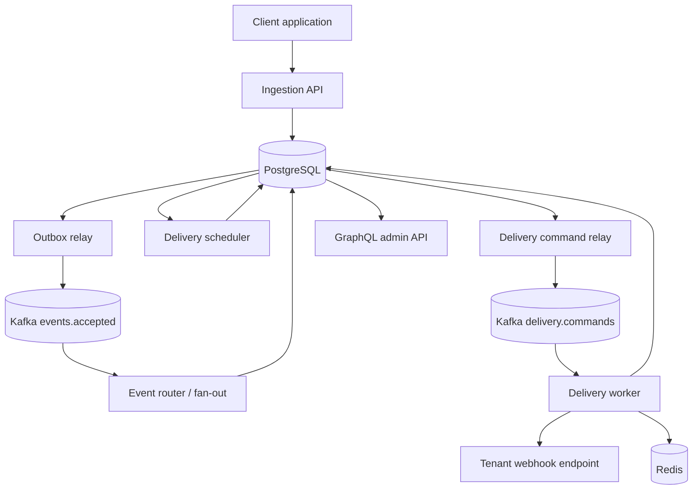

# HookRelay System Context (Bootstrap)

## Purpose

HookRelay accepts tenant events over REST, stores them durably in PostgreSQL, relays work through Kafka, and delivers signed webhooks to tenant endpoints with retry, DLQ, and admin visibility.

## Component boundaries

| Component | Responsibility |
|---|---|
| `ingestion-api` | API key auth, validation, endpoint CRUD, idempotent event accept, outbox write |
| `delivery-worker` | Fan-out, scheduling, outbound HTTP delivery, retry/DLQ, breaker coordination |
| `admin-api` | Tenant-scoped GraphQL queries and mutations |
| `common` | Shared contracts and utilities only |
| PostgreSQL | Source of truth for business state |
| Kafka (KRaft) | Transport/buffer for accepted events and delivery commands |
| Redis | Rate limit and shared circuit-breaker coordination |
| Prometheus/Grafana/OTel | Metrics, dashboards, optional traces |

## High-level flow

## Milestone 0 status

Repository bootstrap, pinned stack, Compose infra, Flyway skeleton, ADR-001/003/004, and CI are in place. Domain features begin in Milestone 1.
